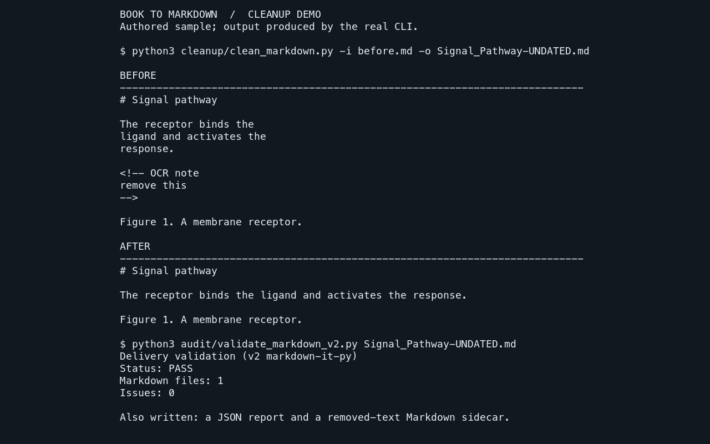

# Book to Markdown

Convert technical and scientific books into page-free Markdown for readers and maintainers who
need editable, reviewable text, with extraction, cleanup, validation, and controlled publication
in one command-line toolchain.

## What it provides

The toolchain keeps each conversion stage explicit: extract source text, repair common
page-layout damage, inspect the Markdown, and promote a reviewed candidate only after its
identity and validation evidence agree. It supports PDFs with text layers, scanned PDFs through
OCR, EPUB, HTML, DOCX, ODT, DjVu, and plain text.

## Cleanup in practice

Book extraction commonly leaves physical line wraps and stray source markup in otherwise useful
text. The cleanup step repairs the prose while preserving the surrounding Markdown structure.

Before cleanup:

```markdown
# Signal pathway

The receptor binds the
ligand and activates the
response.

<!-- OCR note
remove this
-->

Figure 1. A membrane receptor.
```

After cleanup:

```markdown
# Signal pathway

The receptor binds the ligand and activates the response.

Figure 1. A membrane receptor.
```

<!-- screenshots:begin (managed by screenshot-docs) -->


Terminal-style capture of the authored sample above, produced by the real cleanup and validation
commands. Reproduce it with the instructions in [docs/DEVELOPMENT.md](docs/DEVELOPMENT.md).
<!-- screenshots:end -->

## Before you begin

- Use Python 3.12 through `source source_me.sh`; the repository's scripts rely on that environment
  to find sibling modules.
- Install the required Python packages from `pip_requirements.txt`. AZW3 conversion also needs the
  optional package listed in `pip_extra.txt`.
- PDF extraction that uses OCR needs Tesseract and English traineddata. Text-layer PDFs use
  PyMuPDF instead.
- A cleaned file is a staged conversion result. Canonical delivery requires the validation and
  promotion workflow described in [docs/USAGE.md](docs/USAGE.md).

## Quick start

Run the repository-owned demonstration first. It creates temporary authored input, runs the real
cleanup and validation commands, and reports `Status: PASS` without needing a book file:

```bash
source source_me.sh
python3 -m pip install -r pip_requirements.txt
python3 devel/readme_demo.py
```

For a PDF with a usable text layer, create a cleaned staged Markdown file:

```bash
source source_me.sh
python3 extract/pdf_raw_text_extraction_to_markdown.py book.pdf -o /tmp/book.raw.md
python3 cleanup/clean_markdown.py -i /tmp/book.raw.md -o /tmp/book.clean.md
```

The final command writes `/tmp/book.clean.md`. It joins ordinary wrapped prose, removes known
extraction debris, records its cleanup metrics, and preserves protected Markdown structures such
as code fences and tables. Use the [docs/USAGE.md](docs/USAGE.md) workflow for scanned PDFs,
EPUB/AZW3 input, validation, and controlled publication.

## Main capabilities

- Extract page-aware text from PDFs, including a separate OCR route for scanned sources.
- Convert supported ebook and document formats into a common Markdown workflow.
- Repair layout damage while protecting Markdown tables, links, inline code, and fenced code.
- Validate structural Markdown quality and audit duplication or extraction residue.
- Promote an admitted staged candidate with source-bound evidence and safe canonical publication.

## Documentation

Start with the task that matches your need:

- [docs/INSTALL.md](docs/INSTALL.md) - dependencies, optional AZW3 support, and install checks.
- [docs/USAGE.md](docs/USAGE.md) - extraction routes, cleanup flags, validation, and promotion.
- [docs/CODE_ARCHITECTURE.md](docs/CODE_ARCHITECTURE.md) - components, data flow, and extension points.
- [docs/FILE_STRUCTURE.md](docs/FILE_STRUCTURE.md) - repository layout and tool ownership.
- [docs/HUMAN_GUIDANCE.md](docs/HUMAN_GUIDANCE.md) - durable project decisions and operating guidance.
- [docs/DESIGN_DECISIONS.md](docs/DESIGN_DECISIONS.md) - technical lifecycle decisions.
- [docs/FILE_FORMATS.md](docs/FILE_FORMATS.md) - source, staged output, diagnostic, and publication files.
- [docs/CHANGELOG.md](docs/CHANGELOG.md) - recent changes and maintenance notes.

For ecosystem context, [docs/RELATED_PROJECTS.md](docs/RELATED_PROJECTS.md) compares confirmed
companions and possible alternatives.

## Development

Run the repository checks after sourcing the environment:

```bash
source source_me.sh && pytest tests/
```

The project is licensed under the [GNU LGPL v3.0](LICENSE.LGPL-3.0).
